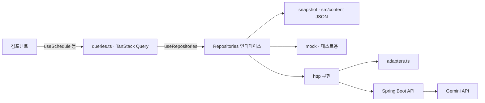

# 설계 메모

목표는 **다음 기수가 고치기 쉬운 코드**입니다. 그래서 "바뀔 가능성이 큰 것"을 한곳에 모으고, 그것만 바꾸면 되도록 나눴습니다.

| 바뀔 것 | 모아 둔 곳 | 쓴 패턴 |
|---|---|---|
| 메뉴 구성, 장소 이름·색 | `config/places.ts` | 데이터 주도 설정 |
| 문구 · 링크 · 연락처 | `config/site.ts` | 설정 한 곳 (null 이면 숨김) |
| 실제 기록 (행사 · 프로젝트 · 기수 · FAQ) | `content/*.json` + `content/validate.ts` | 내용과 코드 분리, 불러올 때 검사 |
| 데이터 출처 (JSON 스냅샷 → Spring Boot) | `data/` | Repository + 의존성 주입 |
| 서버 응답 모양 | `data/http/adapters.ts` | Adapter |
| 불러오기 · 캐시 | `data/queries.ts` | TanStack Query |
| 검색 방법 (키워드 → Gemini) | `services/search/`, `SearchService` | Strategy |
| 건물 지붕 모양 | `features/campus/roofs/` | Strategy + Registry |
| 지도 놓을 자리 | `features/home/HeroSection.tsx` 의 `getLayout` | 배치와 장면 분리 |
| 하위 페이지 머리 장면 · 건물 상태 | `features/placehero/` (`frame.ts` 자리, `look.ts` 상태) | 같은 장면을 다른 viewBox 로, 상태는 데이터에서 계산 |
| 프로젝트 그림 · GitHub 숫자 | `content/projects.json` 의 `cover` · `images` · `languages` … | 내용과 코드 분리 |
| 아직 안 만든 페이지 | `config/pages.ts` → 라우터가 자동 연결 | 설정에서 라우트 만들기 |

## 1. 지도 = 메뉴 (데이터 주도 설정)

`config/places.ts` 의 장소 하나가 메뉴 하나, 건물 하나, 이름표 하나, 미리보기 패널 하나가 됩니다.
메뉴와 지도를 따로 만들면 이름이 어긋나기 쉬워서 한 목록에서 같이 만들게 했습니다.
장소를 더할 때는 `PlaceId` 타입에도 이름을 넣어야 합니다. 빠뜨리면 타입 오류로 알려 줍니다.

## 2. Repository + 의존성 주입

- 컴포넌트는 `queries.ts` 의 훅만 씁니다. 데이터가 예시인지 서버인지 모릅니다.
- 어떤 구현을 쓸지는 `RepositoryProvider` 한 곳에서 정합니다. 기본은 저장소 JSON(snapshot), `.env` 에 `VITE_DATA_SOURCE=http` 면 Spring Boot.
- 서버가 없어도 실제 기록을 보여줄 수 있게 snapshot 을 기본으로 둡니다. 서버가 생기면 같은 인터페이스로 바꿔 끼웁니다.
- 테스트할 때는 `RepositoryProvider value={가짜}` 로 원하는 데이터를 넣을 수 있습니다.

## 3. 서버 응답은 믿지 않는다 (Adapter)

`fetch` 결과를 `as T` 로 넘기면, 서버가 조금만 달라도 화면 곳곳이 조용히 깨집니다.
그래서 `adapters.ts` 가 응답을 한 줄씩 읽어 화면 모양으로 바꾸고, 못 읽는 줄은 버립니다.

- `{ content: [...] }`(Spring Page), `{ data: [...] }` 를 벗김
- 대문자 enum(`SPRINT`), `2026-10-27T18:00:00` 같은 날짜를 맞춤
- 화면이 모르는 장소 · 종류는 그 줄만 버림
- `adapters.test.ts` 가 가짜 `fetch` 로 이 약속을 확인합니다. BE 명세가 나오면 이 테스트부터 맞추면 됩니다.

## 4. 불러오는 중 · 실패 · 비어 있음을 나눈다

예전에는 셋 다 "빈 목록"으로 보였습니다. 서버가 죽어도 "일정이 없습니다"로 보이는 문제가 있었습니다.

- TanStack Query 의 `isPending` · `isError` 로 문구를 나눕니다.
- 미리보기 패널은 3줄 높이를 미리 잡아 두어, 불러오는 동안 화면이 출렁이지 않게 했습니다 (CLS).
- 화면을 그리다 오류가 나면 라우터의 `errorElement`(ErrorPage)가 안내를 보여줍니다.

## 5. Strategy + Registry (지붕, 검색)

- 건물은 `ROOFS[fp.roof]` 로 지붕을 꺼내 그립니다. `if (roof === 'arch')` 같은 분기가 없습니다.
- `Record<RoofType, RoofSpec>` 이라서 새 지붕 이름만 추가하고 등록을 빼먹으면 **타입 오류**가 납니다.
- 검색도 같은 생각입니다. `SearchService` 를 따르는 구현이면 키워드든 서버(Gemini)든 갈아 끼울 수 있습니다.

## 6. 상태: useReducer + Context, 둘로 나눔

지도 · 메뉴 · 패널 · 검색이 `선택한 장소`, `마우스를 올린 장소`, `검색 결과` 를 같이 봅니다.

- `campusReducer` 는 순수 함수라 화면 없이 테스트합니다. 값이 같으면 같은 객체를 돌려줘 리렌더를 막습니다.
- 상태와 바꾸는 함수를 서로 다른 Context 에 둡니다. 메뉴처럼 **바꾸기만** 하는 컴포넌트는 상태가 바뀌어도 다시 그려지지 않습니다.
- 처음 열리는 장소는 '소개'입니다. 처음 온 사람이 무슨 동아리인지부터 보게 합니다.

## 7. 순수 로직은 lib/ 로, 테스트와 함께

날짜(D-n, 달력), 일정 정렬 · 기간 표시, 아이소메트릭 투영, 장면 맞추기, 검색 점수, 사람 경로, 글자 다듬기(하이픈 낱말이 꺾이지 않게, `lib/text.ts`)는 DOM 없이 계산합니다.
그래서 `npm test` 로 바로 확인할 수 있고, 화면 코드는 짧아집니다.

## 8. 1초에 30번 움직이는 것은 React 밖에서

걷는 사람은 계속 위치가 바뀝니다. 이걸 React 상태로 두면 장면 전체가 계속 다시 그려집니다.

- `WalkerLayer` (클래스) 가 사람 노드를 직접 만들고 움직입니다. React 리렌더는 0번입니다.
- 사람은 작고 느려서 1초에 30번이면 충분합니다 (`useWalkers`). 폰에서는 2명만 걷습니다.
- `useAnimationLoop` 가 루프를 하나만 돌리고, 화면 밖이나 다른 탭이면 멈춥니다. '동작 줄이기' 설정도 지킵니다.
- 깃발이 올라가는 움직임은 세션에 한 번만, 지도가 화면에 들어왔을 때 합니다.

## 9. 장면은 화면 배치를 모른다: 가리면 안 되는 것만 지킨다

첫 화면(HeroSection)은 지도 띠의 크기와 피할 자리만 알려주고(`getLayout`), 장면 놓기는 `lib/fit.ts` 의 `fitAvoiding` 이 맡습니다.

- 땅 · 나무 · 길은 화면 끝에서 잘려도 됩니다. **건물 · 깃발 · 안내판**만 잘리면 안 됩니다 (`campus/geometry.ts` 의 `sceneTargets`).
- 큰 배율부터 0.02씩 줄이며, 그 배율에서 가능한 자리 중 '선호 영역' 가운데에 가장 가까운 자리를 고릅니다.
- 안내판은 그리기 전이라 글자 폭을 어림값으로 씁니다 (`estimateLabelWidth`). Pretendard 를 못 받아도 넘치지 않게 넉넉히 잡습니다.
- 안내판 글자는 지도 배율과 상관없이 화면에서 14–16px (폰 13px 이상)로 보이게 따로 키웁니다 (`labelScaleFor`).
- 좁은 화면에서는 오른쪽 끝 장소의 안내판을 왼쪽으로 펼칩니다.
- 땅은 흰색이라 지도 띠가 회색 받침처럼 보이지 않습니다. 위아래 40px 만 흰색으로 흐려 잘린 길을 정리합니다.

## 10. 내용은 JSON, 화면은 코드

- 행사 · 프로젝트 · 기수 · FAQ · 모집 기록은 `src/content/*.json` 에 있습니다. 출처 주소가 없는 줄은 넣지 않습니다.
- `content/validate.ts` 가 불러올 때 모양을 검사하고, `content.test.ts` 가 날짜 형식 · 조사 띄어쓰기 · 이름 통일 · 숫자와 실제 줄 수가 맞는지 확인합니다.
- 공개 프로젝트 수는 `PUBLIC_PROJECTS`(GitHub GDSC-DGU 조직 저장소) 하나로 셉니다. 화면마다 따로 세지 않습니다.
- 행사 목록은 `npm run sync:events` 로 gdg.community.dev 에서 받아옵니다. 자세한 규칙은 [CONTENT.md](CONTENT.md).

## 11. 처음 받는 파일을 줄인다

- 홈만 처음 받는 파일에 넣고, 프로젝트 · 커뮤니티 · 지원 안내 · 준비 중 페이지는 들어갈 때 받습니다 (`app/lazyPages.tsx`).
- 받는 동안 머리말 · 꼬리말은 그대로 두고 본문 자리 높이만 잡아 둡니다.
- 파일 하나로 묶어야 하는 미리보기(아티팩트)는 `VITE_SINGLE_FILE=1` 로 다시 한 파일로 합칩니다.

## 12. 하위 페이지는 '그 건물 앞'에서 시작한다 (PlaceHero)

홈 지도에서 건물을 누르고 들어오면, 하위 페이지도 같은 건물 앞에서 시작해야 같은 장소로 느껴집니다.

- 장면을 새로 그리지 않습니다. 홈 지도와 같은 격자 · 좌표 · 부품(`campus/StaticBuilding.tsx` 는 `Building` 과 같은 조각을 쓰되 누르기만 뺀 것)을 쓰고, `placehero/frame.ts` 가 viewBox 만 그 건물 쪽으로 옮깁니다. 지도를 고치면 머리도 같이 바뀝니다.
- 건물 상태는 `placehero/look.ts` 가 실제 데이터에서 정합니다: G-Sprint 기간(`config/site.ts` 의 `SPRINT`)이면 창에 불, 모집이 열렸는지(`content/recruiting.json`)에 따라 문, 팀원 모집은 공사 중. 화면 코드에 날짜를 적지 않습니다.
- 안내판(목차)은 HTML 이고 장면은 `aria-hidden` 입니다. 화면 읽기 프로그램은 제목 · 리드 · 안내판 링크만 읽습니다.
- 꼬리말의 작은 지도(`campus/MiniCampus.tsx`)도 같은 부품으로, 지금 주소의 건물만 장소색으로 칠합니다.

## 13. 하위 페이지의 계산은 화면 밖에서

- 커뮤니티 '이번 주'(`pages/community/thisWeek.ts`), '세 기수의 1년' 달력(`heatmap.ts`), 기록 묶기(`archive.ts`), 지원 안내 한 해 · 네 파트(`pages/recruits/batches.ts` · `parts.ts`), 프로젝트 전시실 묶기 · 표지 고르기(`pages/projects/exhibit.ts`), G-Sprint 띠 단계 · 주장(`pages/projects/sprint.ts`)은 DOM 없이 계산하고 테스트합니다.
- 프로젝트 자세히 보기 창은 브라우저 기본 `<dialog>` 이고, 열린 프로젝트를 주소 `?p=<id>` 에 남겨 링크로 공유됩니다. 라우터를 건드리지 않고 검색 매개변수만 씁니다.
- 프로젝트 그림은 `teamCleared` 로 팀 확인 여부를 들고 다닙니다. `SHOW_UNCLEARED_IMAGES` 하나로 '확인된 그림만'으로 바꿀 수 있습니다.

## 14. 접근성에서 지킨 것

- 검색: 콤보박스(↓↑ 이동, Enter 열기, Esc 닫기 → 지우기), 결과 건수를 화면 읽기 프로그램에 알림. 고르면 초점이 미리보기 제목으로
- 지도 건물 · 깃발: 키보드로 고를 수 있고, 미리보기를 닫으면 초점이 그 건물로 돌아옴 (`data-place`)
- 고른 장소는 `aria-current`, 미리보기를 `aria-controls` 로 가리킴. 범례가 같은 메뉴를 글자로 한 번 더 제공
- 달력: 표(table)로 읽힘. 날짜 칸마다 'O월 O일'
- 누르는 것은 44px 이상, 본문 바로가기, 키보드 초점 표시. 13px 보다 작은 글자 없음
- hover 반응은 마우스가 있는 화면에서만 (`@media (hover: hover)`), 움직임은 '동작 줄이기'면 끔
- 머리말이 위에 붙어 있어도 초점이 가려지지 않게 본문 · 꼬리말에만 `scroll-margin-top` (머리말 링크에 초점이 가도 화면이 튀지 않음)
- 세 기수의 1년 달력: 칸을 키보드 화살표로 고르고, 손가락으로 누르면 가장 가까운 칸이 골라짐. 고른 칸의 날짜 · 제목 · 장소를 한 줄로 알림
- axe 검사(홈 · 프로젝트 · 자세히 보기 창 · 커뮤니티 · 지원 안내 · 팀원 찾기 × 1440 · 390 · 320, 검색 창 · 폰 메뉴 열린 상태, 동작 줄이기): 위반 0건

## 배포할 때

- `/projects` 같은 주소를 그대로 쓰려면 서버가 모든 주소를 `index.html` 로 보내야 합니다.
  Firebase Hosting 이면 `firebase.json` 의 `hosting.rewrites` 에 `{ "source": "**", "destination": "/index.html" }`.
- 그런 설정을 할 수 없는 미리보기는 `VITE_ROUTER=hash` 로 빌드합니다 (`#/projects`).
- 파일 미리보기 창(about:srcdoc · blob: 주소)에서 열리면 라우터가 알아서 메모리 라우터로 바뀝니다 (`app/router.tsx`).
- 프로젝트 그림 폴더는 `/project-images/` 입니다. `/projects` 주소와 이름이 겹치지 않게 일부러 다르게 했습니다 (서버가 폴더를 먼저 찾으면 페이지가 깨질 수 있음).

## 고친 버그 기록

- **좁은 화면에서 건물을 누르면 첫 화면이 옆으로 밀림**: 장소 카드 줄을 가운데로 맞추려고 `scrollIntoView` 를 썼더니,
  `overflow: hidden` 인 첫 화면까지 가로로 스크롤됐습니다. 카드 줄만 `scrollTo` 로 직접 움직이고, 첫 화면은 `overflow: clip` 으로 막았습니다.
- **G-Sprint 단계 당일에 이미 '완료'로 보임**: 10.27 당일에 중간 발표가 지난 단계로 나왔습니다. 당일은 '지금 단계'(D-day)로 보이게 고쳤습니다 (`pages/timeline.ts` 의 `stepStates`, 날짜 없는 '개발' 단계 정리는 `pages/projects/sprint.ts`). 시안 E 에서 띠를 새로 짜며 한 번 되돌아갔던 것을 다시 고쳤습니다.
- **하위 페이지 머리 장면이 오른쪽으로 15px 넘침**: 장면을 화면 끝까지 늘리는 길이를 `clientWidth` 로 쟀는데, `scrollbar-gutter: stable` 로 막대 자리를 잡아 두면 그 자리를 빼지 않고 알려 주는 브라우저가 있었습니다. html 상자 폭과 둘 중 작은 값을 씁니다 (`placehero/useHeroLayout.ts`).
- **'G-' 만 줄 끝에 남음**: 브라우저는 영문 하이픈 뒤에서 줄을 바꿀 수 있어, 폰에서 'G-Sprint' 가 'G-' / 'Sprint' 로 꺾였습니다. 데이터 글자를 그릴 때 하이픈 뒤에 보이지 않는 낱말 이음표(U+2060)를 넣습니다 (`lib/text.ts`).
- **여러 날 행사가 달을 넘으면 '10.31–02' 로 보임**: `lib/schedule.ts` 의 `rangeLabel` 이 '10.31–11.02' 로 씁니다.
- **미리보기 패널 글이 '…'으로 잘림**: 한 줄 말줄임 대신 줄을 바꿉니다.
- **머리말 링크에 초점이 가면 화면이 위로 튐**: `html { scroll-padding-top }` 때문에 붙어 있는 머리말 안 요소까지 '머리말 아래로' 맞추려 했습니다. 본문 · 꼬리말에만 `scroll-margin-top` 을 줍니다.
- **미리보기를 닫으면 초점이 사라짐**: SVG 건물은 `HTMLElement` 가 아니라서 초점 되돌리기가 건너뛰어졌습니다. `Element` 로 확인하고 `data-place` 로 건물을 찾습니다.
- **파일 미리보기 창에서 'Failed to construct URL: Invalid URL'**: 해시 라우터는 페이지 주소를 기준으로 URL 을 만드는데, about:srcdoc · blob: 주소는 기준이 될 수 없습니다. http(s) 가 아니면 메모리 라우터를 쓰고 처음 위치는 해시에서 읽습니다.
