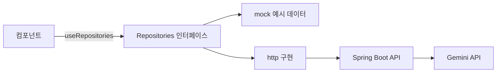

# 설계 메모

목표는 **다음 기수가 고치기 쉬운 코드**입니다. 그래서 "바뀔 가능성이 큰 것"을 한곳에 모으고, 그것만 바꾸면 되도록 나눴습니다.

| 바뀔 것 | 모아 둔 곳 | 쓴 패턴 |
|---|---|---|
| 메뉴 구성, 장소 이름·색 | `config/places.ts` | 데이터 주도 설정 |
| 데이터 출처 (예시 → Spring Boot) | `data/` | Repository + 의존성 주입 |
| 검색 방법 (키워드 → Gemini) | `services/search/`, `SearchService` | Strategy |
| 건물 지붕 모양 | `features/campus/roofs/` | Strategy + Registry |
| 카드 배치 | `features/home/HeroSection.tsx` | 배치와 장면 분리 |

## 1. 지도 = 메뉴 (데이터 주도 설정)

`config/places.ts` 의 장소 하나가 메뉴 하나, 건물 하나, 이름표 하나, 미리보기 패널 하나가 됩니다.
메뉴와 지도를 따로 만들면 이름이 어긋나기 쉬워서 한 목록에서 같이 만들게 했습니다.

## 2. Repository + 의존성 주입

- 컴포넌트는 `Repositories` 인터페이스만 압니다. 데이터가 예시인지 서버인지 모릅니다.
- 어떤 구현을 쓸지는 `RepositoryProvider` 한 곳에서 정합니다 (`.env` 의 `VITE_DATA_SOURCE`).
- 서버 응답 모양이 `domain/types.ts` 와 다르면 `http/` 안에서 바꿔서 넘깁니다. 컴포넌트는 고치지 않습니다.
- 테스트할 때는 `RepositoryProvider value={가짜}` 로 원하는 데이터를 넣을 수 있습니다.

## 3. Strategy + Registry (지붕, 검색)

- 건물은 `ROOFS[fp.roof]` 로 지붕을 꺼내 그립니다. `if (roof === 'arch')` 같은 분기가 없습니다.
- `Record<RoofType, RoofSpec>` 이라서 새 지붕 이름만 추가하고 등록을 빼먹으면 **타입 오류**가 납니다.
- 검색도 같은 생각입니다. `SearchService` 를 따르는 구현이면 키워드든 Gemini 든 갈아 끼울 수 있습니다.

## 4. 상태: useReducer + Context, 둘로 나눔

지도 · 메뉴 · 패널 · 검색이 `선택한 장소`, `마우스를 올린 장소`, `검색 결과` 를 같이 봅니다.

- `campusReducer` 는 순수 함수라 화면 없이 테스트합니다. 값이 같으면 같은 객체를 돌려줘 리렌더를 막습니다.
- 상태와 바꾸는 함수를 서로 다른 Context 에 둡니다. 메뉴처럼 **바꾸기만** 하는 컴포넌트는 상태가 바뀌어도 다시 그려지지 않습니다.
- 앱 전체 상태가 이 정도라 Redux · Zustand 는 아직 넣지 않았습니다.

## 5. 순수 로직은 lib/ 로, 테스트와 함께

날짜(D-n, 달력), 아이소메트릭 투영, 장면 맞추기, 검색 점수, 사람 경로, G-Sprint 진행률은 DOM 없이 계산합니다.
그래서 `npm test` 로 바로 확인할 수 있고, 화면 코드는 짧아집니다.

## 6. 1초에 60번 움직이는 것은 React 밖에서

걷는 사람은 매 프레임 위치가 바뀝니다. 이걸 React 상태로 두면 장면 전체가 계속 다시 그려집니다.

- `WalkerLayer` (클래스) 가 사람 노드를 직접 만들고 움직입니다. React 리렌더는 0번입니다.
- `useAnimationLoop` 가 루프를 하나만 돌리고, 화면 밖이나 다른 탭이면 멈춥니다. '동작 줄이기' 설정도 지킵니다.
- 앞뒤 순서는 정적 물체에 붙인 `data-depth` 를 보고 정합니다. 정적 장면은 처음 그린 뒤 순서가 바뀌지 않으므로 React 와 부딪히지 않습니다.

## 7. 장면은 카드 배치를 모른다

장면은 "어디가 비어 있는지"만 받아서(`getFree`) 그 안에 꽉 차게 그립니다 (`lib/fit.ts`).
카드 위치를 바꿔도 장면 코드는 그대로입니다.

## 고친 버그 기록

- **좁은 화면에서 건물을 누르면 첫 화면이 옆으로 밀림**: 장소 카드 줄을 가운데로 맞추려고 `scrollIntoView` 를 썼더니,
  `overflow: hidden` 인 첫 화면까지 가로로 스크롤됐습니다. 카드 줄만 `scrollTo` 로 직접 움직이고, 첫 화면은 `overflow: clip` 으로 막았습니다.
