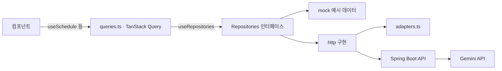

# 설계 메모

목표는 **다음 기수가 고치기 쉬운 코드**입니다. 그래서 "바뀔 가능성이 큰 것"을 한곳에 모으고, 그것만 바꾸면 되도록 나눴습니다.

| 바뀔 것 | 모아 둔 곳 | 쓴 패턴 |
|---|---|---|
| 메뉴 구성, 장소 이름·색 | `config/places.ts` | 데이터 주도 설정 |
| 문구 · 링크 · 연락처 | `config/site.ts` | 설정 한 곳 (null 이면 숨김) |
| 데이터 출처 (예시 → Spring Boot) | `data/` | Repository + 의존성 주입 |
| 서버 응답 모양 | `data/http/adapters.ts` | Adapter |
| 불러오기 · 캐시 | `data/queries.ts` | TanStack Query |
| 검색 방법 (키워드 → Gemini) | `services/search/`, `SearchService` | Strategy |
| 건물 지붕 모양 | `features/campus/roofs/` | Strategy + Registry |
| 카드 배치 | `features/home/HeroSection.tsx` | 배치와 장면 분리 |
| 아직 안 만든 페이지 | `config/pages.ts` → 라우터가 자동 연결 | 설정에서 라우트 만들기 |

## 1. 지도 = 메뉴 (데이터 주도 설정)

`config/places.ts` 의 장소 하나가 메뉴 하나, 건물 하나, 이름표 하나, 미리보기 패널 하나가 됩니다.
메뉴와 지도를 따로 만들면 이름이 어긋나기 쉬워서 한 목록에서 같이 만들게 했습니다.
장소를 더할 때는 `PlaceId` 타입에도 이름을 넣어야 합니다. 빠뜨리면 타입 오류로 알려 줍니다.

## 2. Repository + 의존성 주입

- 컴포넌트는 `queries.ts` 의 훅만 씁니다. 데이터가 예시인지 서버인지 모릅니다.
- 어떤 구현을 쓸지는 `RepositoryProvider` 한 곳에서 정합니다 (`.env` 의 `VITE_DATA_SOURCE`).
- 테스트할 때는 `RepositoryProvider value={가짜}` 로 원하는 데이터를 넣을 수 있습니다.

## 3. 서버 응답은 믿지 않는다 (Adapter)

`fetch` 결과를 `as T` 로 넘기면, 서버가 조금만 달라도 화면 곳곳이 조용히 깨집니다.
그래서 `adapters.ts` 가 응답을 한 줄씩 읽어 화면 모양으로 바꾸고, 못 읽는 줄은 버립니다.

- `{ content: [...] }`(Spring Page), `{ data: [...] }` 를 벗김
- 대문자 enum(`SPRINT`), `2026-10-27T18:00:00` 같은 날짜를 맞춤
- 화면이 모르는 장소 · 종류는 그 줄만 버림
- `adapters.test.ts` 가 가짜 `fetch` 로 이 약속을 확인합니다. BE 명세가 나오면 이 테스트부터 맞추면 됩니다.

## 4. 불러오는 중 · 실패 · 비어 있음을 나눈다

예전에는 셋 다 "빈 목록"으로 보였습니다. 서버가 죽어도 "일정이 없습니다"로 보이는 문제가 있었습니다.

- TanStack Query 의 `isPending` · `isError` 로 문구를 나눕니다.
- 미리보기 패널은 3줄 높이를 미리 잡아 두어, 불러오는 동안 화면이 출렁이지 않게 했습니다 (CLS).
- 화면을 그리다 오류가 나면 라우터의 `errorElement`(ErrorPage)가 안내를 보여줍니다.

## 5. Strategy + Registry (지붕, 검색)

- 건물은 `ROOFS[fp.roof]` 로 지붕을 꺼내 그립니다. `if (roof === 'arch')` 같은 분기가 없습니다.
- `Record<RoofType, RoofSpec>` 이라서 새 지붕 이름만 추가하고 등록을 빼먹으면 **타입 오류**가 납니다.
- 검색도 같은 생각입니다. `SearchService` 를 따르는 구현이면 키워드든 서버(Gemini)든 갈아 끼울 수 있습니다.

## 6. 상태: useReducer + Context, 둘로 나눔

지도 · 메뉴 · 패널 · 검색이 `선택한 장소`, `마우스를 올린 장소`, `검색 결과` 를 같이 봅니다.

- `campusReducer` 는 순수 함수라 화면 없이 테스트합니다. 값이 같으면 같은 객체를 돌려줘 리렌더를 막습니다.
- 상태와 바꾸는 함수를 서로 다른 Context 에 둡니다. 메뉴처럼 **바꾸기만** 하는 컴포넌트는 상태가 바뀌어도 다시 그려지지 않습니다.
- 처음 열리는 장소는 '소개'입니다. 처음 온 사람이 무슨 동아리인지부터 보게 합니다.

## 7. 순수 로직은 lib/ 로, 테스트와 함께

날짜(D-n, 달력), 일정 정렬 · 기간 표시, 아이소메트릭 투영, 장면 맞추기, 검색 점수, 사람 경로, G-Sprint 진행률은 DOM 없이 계산합니다.
그래서 `npm test` 로 바로 확인할 수 있고, 화면 코드는 짧아집니다.

## 8. 1초에 60번 움직이는 것은 React 밖에서

걷는 사람은 매 프레임 위치가 바뀝니다. 이걸 React 상태로 두면 장면 전체가 계속 다시 그려집니다.

- `WalkerLayer` (클래스) 가 사람 노드를 직접 만들고 움직입니다. React 리렌더는 0번입니다.
- `useAnimationLoop` 가 루프를 하나만 돌리고, 화면 밖이나 다른 탭이면 멈춥니다. '동작 줄이기' 설정도 지킵니다.
- 폰에서는 사람을 4명으로 줄입니다.
- 깃발 · 진행 중 표시 같은 CSS 반복 애니메이션도 첫 화면이 화면 밖이면 멈춥니다 (`data-paused`).
- 카드의 반투명 + blur(backdrop-filter)는 지도를 그릴 때마다 비용이 커서 뺐습니다.

## 9. 장면은 카드 배치를 모른다: 카드를 피해 가장 크게

첫 화면(HeroSection)은 카드 자리만 알려주고(`getLayout`), 장면 놓기는 `lib/fit.ts` 의 `fitAvoiding` 이 맡습니다.

- 땅(바닥)은 카드 밑으로 들어가도 됩니다. **건물 · 깃발 · 이름표만** 카드에 가리지 않으면 됩니다 (`campus/geometry.ts` 의 `sceneTargets`).
- 큰 배율부터 0.02씩 줄이며, 그 배율에서 가능한 자리 중 '왼쪽 카드와 오른쪽 카드 사이 가운데'에 가장 가까운 자리를 고릅니다.
- 그래서 넓은 화면일수록 지도가 커집니다 (1903×960 기준 예전보다 약 1.5배).
- 오른쪽 카드 줄은 세로 전체를 한 덩어리로 봅니다. 장소마다 패널 높이가 달라도 지도가 흔들리지 않게 하려는 것입니다.
- 첫 화면 바닥은 흰색으로 흐려지므로 맨 아래 64px 에는 건물을 두지 않습니다.
- 이름표는 그리기 전이라 글자 폭을 어림값으로 씁니다 (`estimateLabelWidth`, 한글 13 · 영문 7.5).
- 1100px 이하에서는 오른쪽 이름표를 왼쪽으로 돌리고 '진행 중' 표시를 뺍니다.
- 카드 순서나 크기를 바꿔도 장면 코드는 그대로입니다. 카드가 늘면 `obstacles` 에 하나 더 넣으면 됩니다.

## 10. 접근성에서 지킨 것

- 검색: 콤보박스(↓↑ 이동, Enter 열기, Esc 닫기 → 지우기), 결과 건수를 화면 읽기 프로그램에 알림
- 캘린더: 표(table)로 읽힘. 날짜 칸마다 'O월 O일'
- 지도 건물 · 장소 카드: 고른 장소는 `aria-current`, 미리보기 패널을 `aria-controls` 로 가리킴
- 흐르는 후기에는 멈춤 버튼. '동작 줄이기' 설정이면 흐르지 않음
- 누르는 것은 44px 이상, 본문 바로가기, 키보드 초점 표시
- axe 검사(첫 화면 1440 · 390, 검색 중, Recruits): 위반 0건

## 배포할 때

- `/projects` 같은 주소를 그대로 쓰려면 서버가 모든 주소를 `index.html` 로 보내야 합니다.
  Firebase Hosting 이면 `firebase.json` 의 `hosting.rewrites` 에 `{ "source": "**", "destination": "/index.html" }`.
- 그런 설정을 할 수 없는 미리보기는 `VITE_ROUTER=hash` 로 빌드합니다 (`#/projects`).

## 고친 버그 기록

- **좁은 화면에서 건물을 누르면 첫 화면이 옆으로 밀림**: 장소 카드 줄을 가운데로 맞추려고 `scrollIntoView` 를 썼더니,
  `overflow: hidden` 인 첫 화면까지 가로로 스크롤됐습니다. 카드 줄만 `scrollTo` 로 직접 움직이고, 첫 화면은 `overflow: clip` 으로 막았습니다.
- **G-Sprint 단계 당일에 이미 '완료'로 보임**: 10.27 당일에 중간 발표가 체크 표시로 나왔습니다. 당일은 '지금 단계'로 보이게 고쳤습니다 (`lib/sprint.ts`).
- **여러 날 행사가 달을 넘으면 '10.31–02' 로 보임**: `lib/schedule.ts` 의 `rangeLabel` 이 '10.31–11.02' 로 씁니다.
- **폰에서 배경 도형이 카드 위에 그려짐**: 흐름 안의 카드에 `position: relative; z-index: 1` 을 주어 도형 위로 올렸습니다.
- **화면 오른쪽 끝에서 배경 도형이 잘려 보임**: 고리 모양이 또렷한 도형이 화면 끝에서 반만 잘려 깨진 것처럼 보였습니다. 크게 흐린 빛(blur 56px)으로 바꿨습니다.
- **미리보기 패널 글이 '…'으로 잘림**: 한 줄 말줄임 대신 줄을 바꿉니다.
